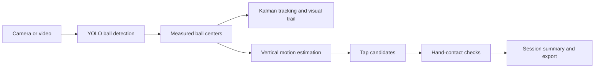

# Hammer Drill Motion Analysis

A local computer-vision application for tracking a golf ball, estimating its motion, and reviewing hammer drill sessions.

The drill involves repeatedly tapping a falling golf ball upward with a hammer head. This application turns webcam input or a recorded video into an annotated ball trajectory, vertical motion estimates, and a session summary that can be reviewed and exported.

[Getting started](#getting-started) | [Usage](#usage) | [How it works](#how-it-works) | [Calibration](#calibration) | [Troubleshooting](#troubleshooting)

## Features

- **Live sessions:** start, pause, resume, and finish a drill with a connected webcam.
- **Complete video review:** analyze an entire uploaded recording, independently of preview playback or seeking.
- **Ball tracking:** view detections and a rolling trajectory with Kalman predictions during detection gaps.
- **Motion estimates:** inspect vertical position, direction, velocity, and acceleration.
- **Hand-contact checks:** check palm and finger landmarks near candidate taps to identify likely hand-assisted movement.
- **Session feedback:** review estimated taps, streaks, inferred streak breaks, and excluded candidates.
- **Reports:** add session notes, download a JSON summary, print a review, or export offline measurements and annotated video.

Processing runs on the computer hosting the application. Launching the UI does not install packages or download model weights.

## Getting started

### Requirements

- **Python 3.11 or later.** Development has been verified with Python 3.11 on Windows.
- A browser and the dependencies in [requirements.txt](requirements.txt).
- The model files listed below.
- A webcam for live sessions; recorded-video analysis does not require one.

### First-time setup

Clone or download the repository, open the project folder in PowerShell, and run:

```powershell
py -3 -m venv .venv
.\.venv\Scripts\python.exe -m pip install -r requirements.txt
.\.venv\Scripts\python.exe run.py --check
.\.venv\Scripts\python.exe run.py
```

The dashboard opens at **http://127.0.0.1:5000**. If it does not open automatically, visit that address in your browser. Keep the terminal open while using the application; press **Ctrl+C** to stop it.

For subsequent sessions, run only:

```powershell
.\.venv\Scripts\python.exe run.py
```

Using the environment's Python executable directly avoids needing a PowerShell activation step.

### Already have the dependencies installed?

If the project dependencies are available in your system Python, use the Windows launcher:

```powershell
.\run.hammer_drill.cmd
```

You can also double-click **run.hammer_drill.cmd**. This launcher uses the system Python launcher rather than automatically selecting `.venv`. Its direct Python equivalent is `py -3 run.hammer_drill`.

### Launch options

Use the same Python interpreter that contains the dependencies:

```powershell
.\.venv\Scripts\python.exe run.py --check
.\.venv\Scripts\python.exe run.py --no-browser
```

`--check` inspects installed dependencies and model-file presence. `--no-browser` starts the server without opening a browser tab.

### Required models

| File | Purpose |
| --- | --- |
| `models/yolov8n-f2.pt` | Golf-ball detection. |
| `models/hands/palm_detection_mediapipe_2023feb.onnx` | Palm detection near candidate taps. |
| `models/hands/handpose_estimation_mediapipe_2023feb.onnx` | 21-landmark hand estimation. |

Keep the files at these paths. Missing weights are not downloaded automatically. Hand-model source URLs and checksums are recorded in [models/hands/manifest.json](models/hands/manifest.json).

The optional [requirements-performance.txt](requirements-performance.txt) adds ONNX Runtime for hand inference. When it is installed, the hand models use it; otherwise, the application selects OpenCV DNN.

## Usage

### Live drill

1. Optionally enter a session name and tap target.
2. Choose **Start a live drill**, then **Start session**.
3. Keep the full ball path visible. Use a steady camera, adequate lighting, and a contrasting background.
4. Pause or resume as needed, then select **Finish session**.
5. Review the results, add notes, and download or print the session report.

The application uses webcam index `0` on the computer running the server. A remote browser does not provide its own camera feed.

### Recorded video

1. Choose **Review a recording** and upload a video.
2. Preview, pause, or seek to inspect specific moments.
3. Select **Finish review** at any point to analyze the entire recording.
4. Follow the analysis progress, then review and export the complete results. You can cancel and retry the analysis.

The final review processes the video from its first frame to its last. You do not need to watch the full recording, and preview position does not limit the final results. Seeking resets the preview measurements only.

Supported uploads are **MP4, AVI, MOV, MKV, and WEBM**, up to **500 MB**. Readability depends on the codecs supported by OpenCV. Processing every frame can make playback and analysis slower than the source video.

Local recordings under `data/videos/` are excluded from Git. Supply your own video if the default offline input, `data/videos/Javed.mp4`, is unavailable.

### Understanding the results

| Result | Interpretation |
| --- | --- |
| Estimated taps | Motion reversals that pass the configured motion and hand-contact checks. |
| Current and best streak | Consecutive accepted taps before an inferred streak break. |
| Streak breaks | Timeouts following a counted tap, including periods without detection; these are not verified missed strikes. |
| Ignored taps | Candidates excluded because of likely hand contact or an unavailable/strictly uncertain hand check. |
| Uncertain counted taps | Accepted candidates whose hand pose was unclear under the default policy. |
| Motion estimates | Calibrated image coordinates and their vertical derivatives. |

Finishing a session closes the active streak without inventing a missed strike. The downloaded JSON includes the finalized summary, event timeline, rejected-candidate audit, session name, optional target, and session notes. Download or print the review before starting another session to retain your notes.

## How it works

The application uses a shared frame-processing pipeline for live input, uploaded-video review, and offline analysis.



**Detection and tracking.** The detector selects the highest-confidence golf-ball detection above the configured threshold. A four-state Kalman filter models position and velocity, providing predicted trail points when detections are missing.

**Motion estimation.** A timestamp-aware, second-order polynomial fits up to seven recent measured vertical positions. Output begins after three samples. The first and second derivatives estimate vertical velocity and acceleration. Video timestamps use frame index and source FPS; live timestamps use a monotonic clock. Predicted points are excluded from dashboard derivatives, and measurement gaps longer than 0.5 seconds reset the fit.

**Tap validation.** A falling-to-rising reversal must pass velocity, travel-distance, duration, and cooldown checks. Candidate taps then trigger hand inference on the current ball-centered crop and at most one earlier crop within 120 ms. Overlap with palm or finger geometry in either sample excludes the candidate. With `HAND_REJECT_UNCERTAIN=False`, unclear poses remain counted and flagged; missing or broken hand models exclude candidates as unverified.

**Dashboard updates.** Flask streams annotated video through MJPEG and publishes statistics through Server-Sent Events. Complete-recording analysis runs separately from preview playback and does not render every processed frame.

## Calibration

Position, velocity, and acceleration values depend on the camera scale in [config.py](config.py). The default `PIXELS_PER_METER = 2650.0` is a preset, not a calibration guaranteed to fit every recording.

1. Place a reference of known length in the same plane as the ball's movement.
2. Measure its length in pixels at the recording resolution.
3. Calculate the scale and update `PIXELS_PER_METER`.
4. Restart the application before analyzing the recording.

```text
pixels_per_meter = reference_length_pixels / reference_length_meters
position_meters  = position_pixels / pixels_per_meter
```

For example, a 0.20 m reference spanning 530 pixels gives a scale of 2650 pixels per meter. This example illustrates the calculation, not the origin of the default value.

Recalibrate after changing camera distance, resolution, cropping, or zoom. A single scale cannot correct perspective or movement outside the calibration plane. Coordinates use the image origin, with positive vertical velocity indicating downward movement.

## Configuration

Edit [config.py](config.py) and restart the application to apply changes.

| Setting | Default | Purpose |
| --- | --- | --- |
| `CONFIDENCE_THRESHOLD` | `0.2` | Minimum ball detection confidence. |
| `PIXELS_PER_METER` | `2650.0` | Pixel-to-meter conversion scale. |
| `SG_BUFFER_SIZE` / `SG_POLY_ORDER` | `7` / `2` | Motion window and polynomial order. |
| `HIT_MIN_FALL_VELOCITY` | `0.05` m/s | Minimum peak downward speed for a candidate tap. |
| `HIT_MIN_FALL_DISTANCE` | `0.006` m | Minimum falling excursion to reduce small-motion jitter. |
| `HIT_MIN_FALL_DURATION` | `0.04` s | Minimum interval from falling-state entry to reversal. |
| `MISS_TIMEOUT_SECONDS` | `3.0` s | Timeout used to infer a streak break. |
| `HAND_CHECK_ENABLED` | `True` | Enable hand-contact validation. |
| `HAND_REJECT_UNCERTAIN` | `False` | Also exclude candidates with an ambiguous hand pose. |

Server settings use the environment variables `TRACKER_HOST`, `TRACKER_PORT`, `TRACKER_DEBUG`, and `TRACKER_SECRET_KEY`. Defaults bind to `127.0.0.1:5000` with debugging disabled.

## Offline analysis

Run these commands from the project folder with the environment containing the dependencies. Replace `recording.mp4` with your own video path; quote paths that contain spaces.

```powershell
# Export measurements, a summary, and annotated video
.\.venv\Scripts\python.exe scripts/analyze_video.py "recording.mp4"

# Export measurements and summary without rendering video
.\.venv\Scripts\python.exe scripts/analyze_video.py "recording.mp4" --no-video

# Compare tap-detection thresholds
.\.venv\Scripts\python.exe scripts/visualise_hit_sweep.py "recording.mp4" --output outputs/plots/sweep.png

# Compare processing cost with and without hand validation
.\.venv\Scripts\python.exe scripts/benchmark_hand_contact.py "recording.mp4" --output outputs/reports/hand_benchmark.json
```

The analyzer creates a unique directory under `outputs/runs/`:

| Output | Contents |
| --- | --- |
| `measurements.csv` | Frame timestamps, measured positions, motion estimates, events, and hand-check status. |
| `summary.json` | Final counts, streaks, event timeline, rejection audit, and motion aggregates. |
| `annotated.mp4` | Video with tracking and session annotations; omitted with `--no-video`. |

Use `--max-frames 30` for a short processing check. An explicit `--output-dir` reuses that directory and can replace same-named files. Parameter sweeps save a plot and JSON summaries; benchmark reports contain processing timings rather than camera-to-screen latency.

## Project structure

```text
app.py                  Flask application and HTTP routes
run.py                  Launcher and dependency/model check
run.hammer_drill         Python launcher alias
run.hammer_drill.cmd     Windows terminal and double-click launcher
config.py               Paths, calibration, thresholds, and server settings
stream.py               Video capture, playback, MJPEG, and statistics streaming
review.py               Background complete-recording analysis
state.py                Browser sessions and analytics aggregates
pipeline/               Detection, tracking, motion, hand checks, and annotation
static/                 Browser JavaScript and responsive styles
templates/              Dashboard HTML
models/                 Ball and hand model files
scripts/                Offline analysis, parameter sweeps, and profiling
tests/                  Python and frontend regression tests
docs/                   Architecture and implementation notes
notebooks/              Standalone tracking prototypes
third_party/            Model adapters, attribution, and license notices
data/                   Local recordings and archives
uploads/                Locally stored uploaded recordings
outputs/                Generated video, measurements, plots, and reports
```

The maintained application uses `pipeline/`; notebook prototypes are separate implementations. Runtime uploads, generated outputs, and local video/archive contents are excluded by `.gitignore`.

## Tests

Run the Python suite with the environment used for setup:

```powershell
.\.venv\Scripts\python.exe -m unittest discover -v
```

Frontend checks additionally require Node.js. The frontend harness renders the Flask template using `py -3`, so that interpreter must also have the project dependencies installed:

```powershell
node --check static/app.js
node --test tests/frontend.test.cjs
```

Tests cover motion timing, contact geometry, event accounting, capture lifecycle, request validation, session isolation, full-video review, and frontend controls. Synthetic trajectories and mocked captures verify behavior; they do not establish real-world accuracy or physical webcam performance.

## Troubleshooting

| Problem | What to check |
| --- | --- |
| Launcher is not recognized | Run `.\run.hammer_drill.cmd` from the project folder, or use the virtual environment's Python with `run.py`. |
| A Python package is missing | Use the same interpreter for installation and launch. Check it with `run.py --check`. |
| A required model is missing | Check the model paths above. The launcher does not retrieve weights. |
| The browser does not open | Open the printed dashboard URL manually. |
| Port 5000 is busy | Stop an earlier instance, or set `$env:TRACKER_PORT="5001"` before launching. |
| The webcam cannot open | Check OS camera permissions and close other applications using camera index `0`. |
| Video upload fails | Check the supported format, codec readability, and 500 MB upload limit. |
| Analysis is slow | Processing preserves every video frame. Speed depends on hardware, resolution, and hand-inference workload. |
| Results look inaccurate | Review camera framing, lighting, motion blur, hand-check flags, calibration, and thresholds. |

## Limitations and data handling

- **Motion and event results are estimates.** Occlusion, blur, perspective, and missed detections affect tracking. Constant-velocity predictions can drift during an unseen tap or bounce.
- **Hand overlap does not prove physical contact.** A single-camera view can confuse projected overlap with touching. Brief overlap may exclude a genuine tap, and missed hands may allow an incorrect one.
- **Tap logic is heuristic.** Streak breaks are inferred from timeouts. Small genuine taps may be excluded by motion thresholds, while unrelated movements can still generate candidates.
- **Performance is hardware-dependent.** Live input is supported, but processing is not guaranteed to sustain the camera's source frame rate. Offline timing does not measure camera-to-browser latency.
- **The server is intended for local use.** There is no authentication. Browser tabs share their session, in-memory analysis state is lost on restart, and multiple server workers need a separate shared-state design.
- **Uploads remain on the host computer.** Session names, targets, and notes stay in the browser until exported. Download your report before starting another session.

## Documentation and acknowledgements

- [Architecture and HTTP interface](docs/architecture.md)
- [Hand-model notes](models/hands/README.md)
- [Model sources and checksums](models/hands/manifest.json)
- [OpenCV Zoo notices](third_party/opencv_zoo/NOTICE.md) and [license](third_party/opencv_zoo/LICENSE)

The application uses Ultralytics YOLO for golf-ball detection and MediaPipe palm/hand models through OpenCV Zoo adapters. Attribution for bundled third-party components is retained with the corresponding assets.
